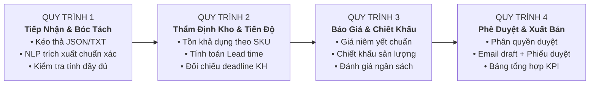

# HỆ THỐNG AI AGENT 4 QUY TRÌNH XỬ LÝ CƠ HỘI BÁN HÀNG B2B - CÔNG TY MINH AN
**Học phần:** AI301 | **Đề số 01**

Hệ thống được thiết kế và chia tách thành **4 quy trình nghiệp vụ rõ ràng** với cơ chế kéo thả dữ liệu (Drag & Drop), bóc tách chuẩn xác bằng NLP, và luồng tự động hóa liên hoàn (Auto-Pipeline Execution).

---

## 4 Quy Trình Nghiệp Vụ Chuẩn



1. **Quy trình 1: Tiếp nhận Dữ liệu & Bóc tách Thực thể Chuẩn xác:**
   - Hỗ trợ kéo thả trực tiếp tệp `.json` từ máy tính hoặc dán dữ liệu.
   - Bóc tách chuẩn xác khách hàng, SKU model, số lượng, ngân sách (hỗ trợ cả định dạng "270.000.000 VNĐ", "160 triệu", "80tr", "1.5 tỷ"), thời hạn và chiết khấu.
   - Khi nạp dữ liệu xong, luồng quy trình sẽ **tự động kích hoạt liên hoàn** qua 4 bước.
2. **Quy trình 2: Thẩm định Tồn kho & Thời gian Đáp ứng (Lead Time):**
   - Đối chiếu tồn kho khả dụng tại từng kho (Hà Nội, TP.HCM).
   - Tính toán thời gian sẵn sàng giao và kết luận Kịp tiến độ hay Trễ tiến độ.
3. **Quy trình 3: Báo giá Đề xuất & Tính toán Chiết khấu:**
   - Tra cứu giá niêm yết mới nhất (không dùng giá cũ).
   - Áp dụng ma trận chiết khấu theo sản lượng và yêu cầu của khách hàng.
   - Tính toán giá ròng và chênh lệch ngân sách.
4. **Quy trình 4: Phân luồng Phê duyệt & Xuất Văn bản:**
   - Kiểm tra hạn mức: NVKD ($\le 8\%$ & $\le 200$tr), Trưởng phòng ($\le 20\%$ & $\le 1$ tỷ), Ban Giám đốc ($> 20\%$).
   - Phân loại 4 trạng thái chuẩn: *Có thể tiếp tục*, *Cần bổ sung thông tin*, *Chưa đáp ứng*, *Chờ duyệt*.
   - Xuất Hồ sơ cơ hội, Email nháp, Phiếu trình duyệt và Bảng tổng hợp KPI.

---

## Hướng Dẫn Sử Dụng Localhost Web Platform

1. **Truy cập Giao diện Web:**
   👉 Mở trình duyệt tại: **`http://localhost:8080`**

2. **Cách Thao Tác Chạy Luồng Tự Động:**
   - **Bước 1:** Kéo thả tệp `.json` (hoặc tệp đề thi mới của Giảng viên) vào khung **Drag & Drop**, hoặc nhấn nút *"⚡ Dùng 6 Kịch Bản Mẫu"*.
   - **Bước 2:** Hệ thống tự động kích hoạt **Luồng Quy Trình Tự Động (Auto-Pipeline)**:
     - Thanh tiến trình chạy mượt mà từ Quy trình 1 $\rightarrow$ Quy trình 2 $\rightarrow$ Quy trình 3 $\rightarrow$ Quy trình 4.
     - Dữ liệu ở từng bước được điền tức thời vào các bảng tương ứng.
   - **Bước 3:** Xem Hồ sơ cơ hội, Bản nháp Email gửi khách hàng, Phiếu trình duyệt Lãnh đạo và Nhật ký Audit Log.
   - **Bước 4:** Bấm nút *"🗑️ Xóa Trắng (Reset)"* để xóa dữ liệu về 0 trước khi nạp bộ kiểm thử tiếp theo.

3. **Chạy Lệnh Terminal (CLI):**
   ```powershell
   python main.py --data data/sample_requests.json
   ```
